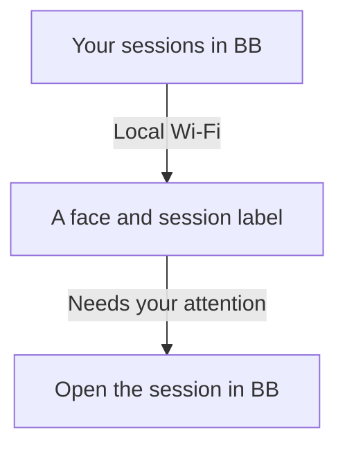
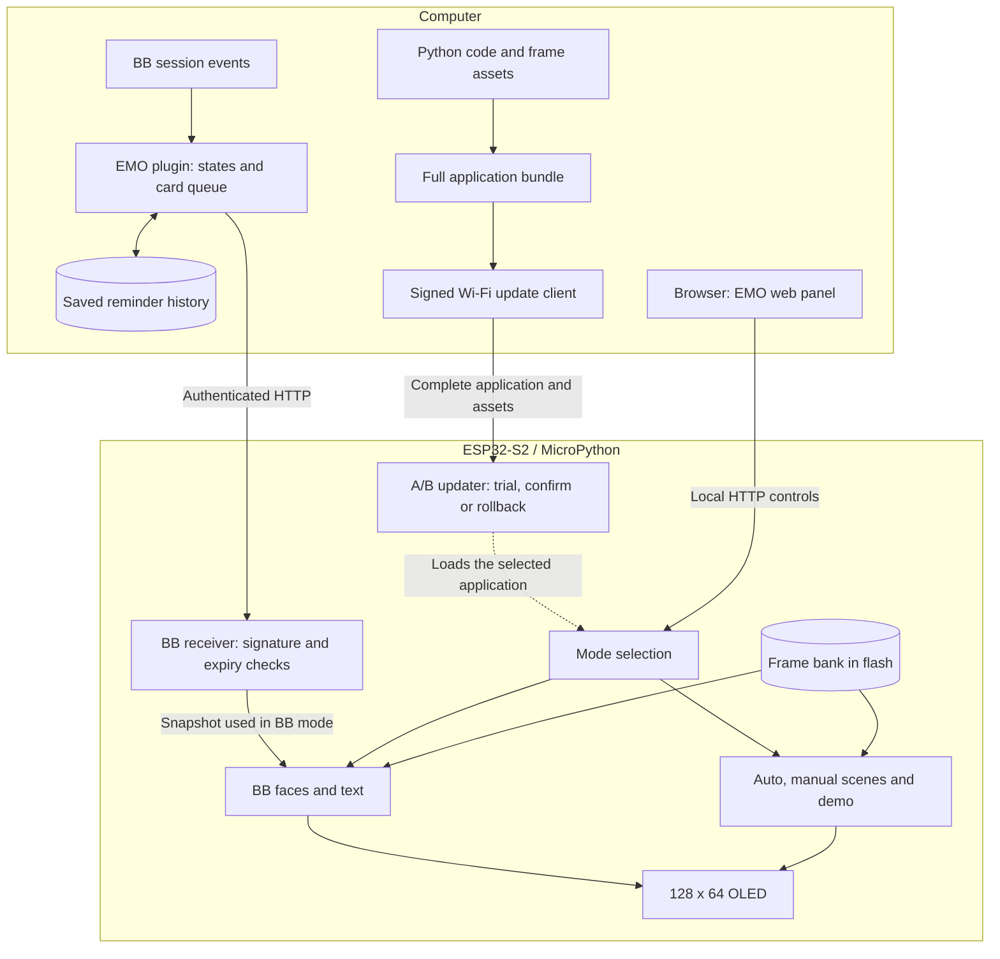

<picture>
  <source media="(prefers-color-scheme: dark)" srcset="assets/readme/hero-dark.svg">
  <source media="(prefers-color-scheme: light)" srcset="assets/readme/hero-light.svg">
  
</picture>

# Give your coding sessions a face.

**Version 0.3** · [Release notes](CHANGELOG.md)

EMO is a DIY desk display for coding agents in [BB](https://getbb.app). A face and a scrolling label show which session needs your attention.

**[Build your EMO](docs/build.md)** &nbsp; · &nbsp; [See it in action](#a-moment-at-your-desk) &nbsp; · &nbsp; [How it works](#how-it-works)

*Tested with BB on macOS, an ESP32-S2 board, and a 128 × 64 OLED. Requires assembly and local Wi-Fi.*

## A moment at your desk

<picture>
  <source media="(prefers-reduced-motion: reduce)" srcset="assets/readme/demo-poster.png">
  
</picture>

*Staged demo with real screen graphics and timing. Display labels are currently in Russian. [View a still image](assets/readme/demo-poster.png).*

## Know when to step in

- A question face means an agent needs your answer. Open that session in BB to reply.
- A wink marks an unread reply. Reminders stop when you read it, start a new turn, or stop the turn.
- An error face marks a failed session. Open BB to see what went wrong.

These notices take turns on the display. Choose which projects to follow, or hide individual sessions without stopping their work.

## Pick a mood

Select **auto** in the web panel to let EMO look around, get sleepy, or play a scene. Pick one face, or use **demo** to see the full set. Return to **BB** mode to show session notices.

EMO has no sound. Its speech animations only move the mouth.

See the web controls

Choose a mode, face, or scene in your browser. A manual selection stays active until you change it or restart EMO.

*Panel preview with example state.*

## How it works

The BB plugin sends session states over local Wi-Fi. EMO starts in BB mode at power-on or restart. Read messages and answer questions in BB.

Explore the full project

Explore the [plugin](bb-plugin-emo/README.md), [display code](emo_bb_display.py), and [frame player](emotions.py). The [updater guide](handoff/wifi-updates.md) covers installation and recovery.

## Build your EMO

The build guide lists the tested parts and walks through wiring, installation, and BB setup. You need USB for the first install. Later application updates use Wi-Fi.

**[Start the build guide](docs/build.md)**

For an existing device, follow the [update instructions](docs/build.md#update-an-existing-device). Manage tracked sessions with the [plugin guide](bb-plugin-emo/README.md).

## Project notes

EMO is a working DIY prototype. Use a trusted local network: the web controls have no authentication. See [security and publication status](SECURITY.md).

The code license and third-party artwork permissions are not yet finalized. See [credits and reuse status](docs/credits.md).

Test results and limits

[Local checks](preview/bb-default-start/checks.json) and a [twelve-round device check](preview/bb-default-start/live.json) passed on the recorded build. These results cover that run. Long-term reliability remains untested.

