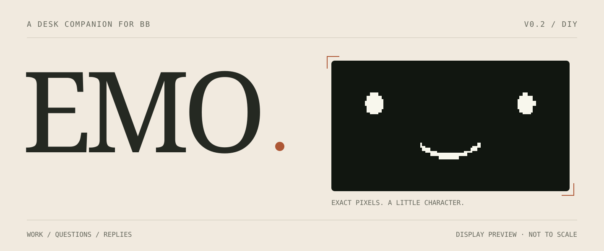
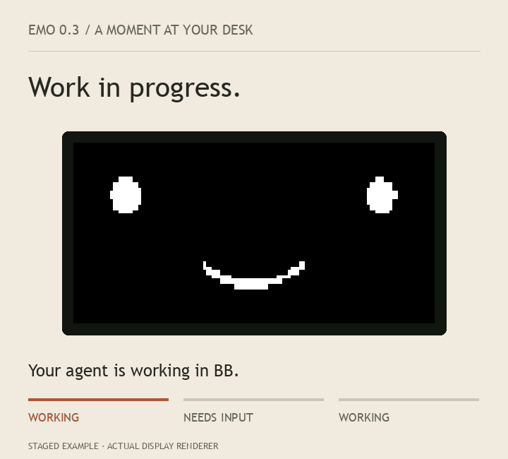
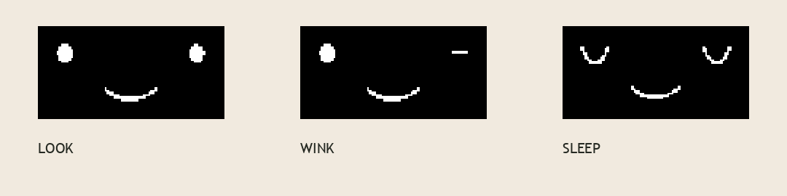
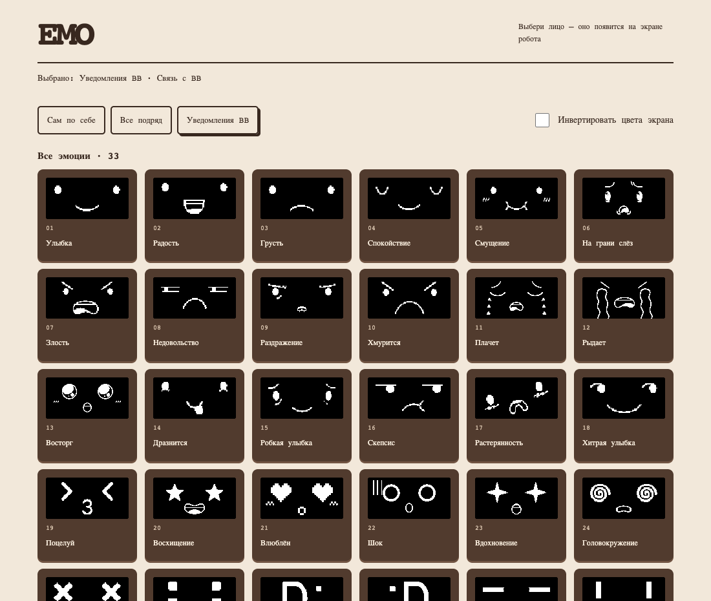
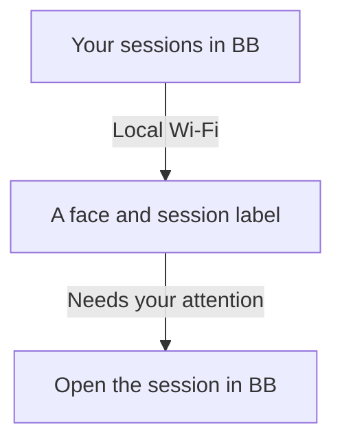
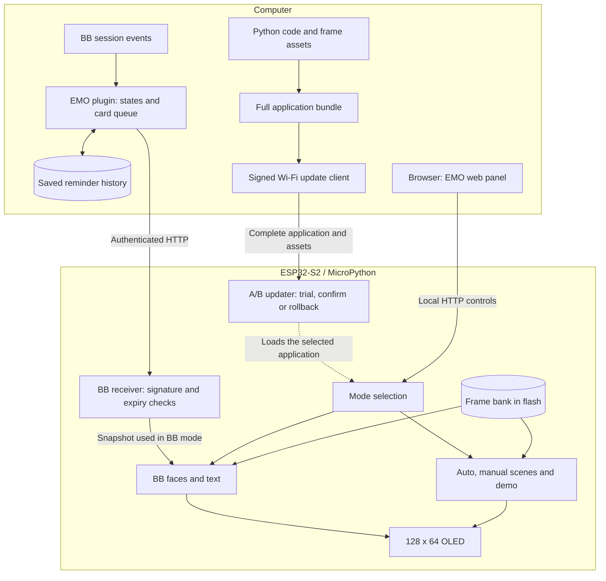

<picture>
  <source media="(prefers-color-scheme: dark)" srcset="assets/readme/hero-dark.svg">
  <source media="(prefers-color-scheme: light)" srcset="assets/readme/hero-light.svg">
  
</picture>

# Give your coding sessions a face.

EMO is a small desk display for [BB](https://getbb.app). It shows which sessions need your attention.

An agent needs a decision. A reply is ready to read. A session has an error. EMO gives each state a face.

**[Build your EMO](docs/build.md)** &nbsp; · &nbsp; [See it in action](#a-moment-at-your-desk) &nbsp; · &nbsp; [How it works](#how-it-works)

*A DIY project for BB on macOS. Hardware assembly and software setup are required.*

## A moment at your desk

Your agent works in BB. When it needs your input, EMO changes its face and shows the session label. You answer in BB.

<picture>
  <source media="(prefers-reduced-motion: reduce)" srcset="assets/readme/demo-poster.png">
  
</picture>

*Staged example using the actual display renderer and its timing. The current display labels are in Russian. [View a still image](assets/readme/demo-poster.png).*

## Know when to step in

**A question needs your answer.** EMO shows the session label. Open that session in BB to read the question and respond.

**A reply is waiting.** A wink marks an unread reply. EMO reminds you until you read it, start a new turn, or stop the turn.

**Something went wrong.** An error has its own face and label. Questions, errors, and unread replies take turns on the display.

You choose which BB projects to follow. You can hide individual sessions from EMO without stopping their work.

## A little character between tasks

Switch to **auto** for changing moods and short scenes. Choose a face in the web panel, or use **demo** to see the full set.

The speech animations move the mouth; they have no sound. EMO starts in BB mode after power-on or restart.

See the web controls

Choose a mode, face, or scene in your browser. A manual selection stays active until you change it or restart EMO.

*Local panel preview with example state. It does not show a live device.*

## How it works

BB and EMO communicate over your local network. The display shows session labels and states. You read messages and answer questions in BB.

Explore the full project

The [plugin](bb-plugin-emo/README.md) selects cards and saves reminder history. The [display code](emo_bb_display.py) draws faces and text. The [frame player](emotions.py) reads frames from flash. The [updater guide](handoff/wifi-updates.md) covers installation, confirmation, and recovery.

## Build your EMO

The tested build uses a LILYGO ESP32-S2 WOOR V1.1 board and an SSD1306 I²C OLED. You also need wires, a breadboard, USB power, and a data cable for the first install.

The current setup uses BB on macOS and a 2.4 GHz Wi-Fi network. After the first USB install, full application updates use Wi-Fi.

**[Start the build guide →](docs/build.md)**

Already have a configured device? Use the [update instructions](docs/build.md#update-an-existing-device). Want to change which sessions appear? Open the [plugin guide](bb-plugin-emo/README.md).

## Project notes

EMO is a working DIY prototype. Local checks and a twelve-round panel-and-delivery check passed on the [documented build](preview/bb-default-start/checks.json). [Device results](preview/bb-default-start/live.json) describe that run, not a long-term reliability guarantee.

Use a trusted local network. The web controls have no authentication. See [security and publication status](SECURITY.md) before exposing or publishing this project.

The code license and third-party artwork permissions are not yet finalized. See [credits and reuse status](docs/credits.md).
